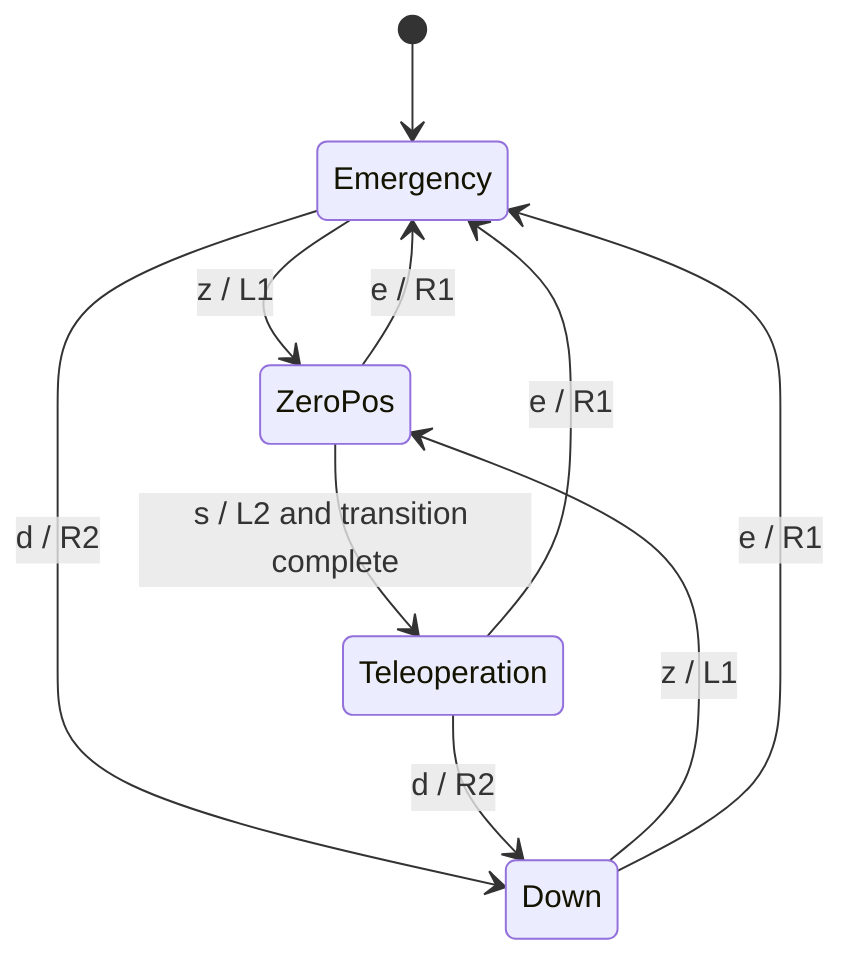

# DR02 Pro State Machine and Pico Control

**English** | [简体中文](STATE_MACHINE_CN.md) ·
[Back to the DR02 Pro Pico Teleoperation Guide](../README.md)

This is the runtime reference for the `dr02_tele` `state_machine`. It describes
interfaces, state transitions, Pico mapping, command protection, and
diagnostics. For real-robot environment preparation and the complete startup
procedure, see [Real-Robot Teleoperation](REAL_ROBOT.md). For simulation
environment preparation and the complete startup procedure, see
[Simulation Teleoperation](SIMULATION.md).

## 1. Control Loop and ROS 2 Interfaces

`state_machine` creates a ROS 2 node named `sdk_deploy`. Its main loop wakes
every 2 ms, but it executes state control and publishes a new command only when
the local receive timestamp for `/JOINTS_DATA` changes. The effective control
rate therefore follows joint feedback; it is not a fixed 500 Hz.

| Interface | Direction | Purpose |
| --- | --- | --- |
| `/JOINTS_DATA` | Subscribe | 31-DoF position, velocity, torque, temperature, and status feedback; each new frame triggers one control update. |
| `/JOINTS_CMD` | Publish | Complete 31-DoF position-PD command. |
| `/GAMEPAD_KEY` | Subscribe | Optional state input recognizing the strings for L1, L2, R1, and R2. |

`wait data update` means that no `/JOINTS_DATA` frame has arrived. Before the
first frame, the program does not enter its initial state or publish
`/JOINTS_CMD`.

## 2. Joint-Control Ownership

| Joint indices | Part | Target source in `Teleoperation` |
| --- | --- | --- |
| `0-2` | Waist | Relative headset orientation. |
| `3-9` | Left arm | Dual-arm IK from the left Pico controller's 6D target. |
| `10-16` | Right arm | Dual-arm IK from the right Pico controller's 6D target. |
| `17-28` | Legs | Target captured on state entry; Pico does not update it. |
| `29-30` | Neck | Target captured on state entry; Pico does not update it. |

The state machine always constructs a 31-joint command. Which joint targets a
real robot ultimately accepts also depends on its current Developer Mode. This
project is approved only for Upper-Body Joint Control Developer Mode.

## 3. State Transitions



| State | Command behavior |
| --- | --- |
| `Emergency` | Captures feedback position on entry and uses position PD to hold that pose. It is not power-off, damping, or a hardware emergency stop. |
| `ZeroPos` | Uses a cubic spline to move all 31 joint commands to zero over three seconds, then holds zero. |
| `Teleoperation` | Initializes Pico/PXREA, seeds targets from the entry pose, updates waist and arms, and holds leg and neck targets. |
| `Down` | Moves waist and arms to the down pose over three seconds while holding leg and neck entry targets. |

## 4. Keyboard and Robot Gamepad Input

| Input | Valid state | Result |
| --- | --- | --- |
| `z` / L1 | `Emergency`, `Down` | Request `ZeroPos`. |
| `s` / L2 | `ZeroPos` | Request `Teleoperation`; if the three-second zero transition is still running, the switch occurs when it finishes. |
| `d` / R2 | `Emergency`, `Teleoperation` | Request `Down`. |
| `e` / R1 | Any state | Request the software `Emergency` pose hold. |

Keyboard input is case-insensitive. The robot gamepad publishes
`G20_KEY_L1`, `G20_KEY_L2`, `G20_KEY_R1`, or `G20_KEY_R2` on `/GAMEPAD_KEY`.
If a button is pressed in a state where its transition is not allowed, the
state machine does not switch states and prints why the request was ignored.

## 5. Pico Anchoring and Control Behavior

On entry to `Teleoperation`, the state machine first reads current 31-joint
feedback, initializes IK, targets, and filters, and then starts PXREA. The robot
therefore does not jump directly toward an absolute Pico pose.

### Controllers Drive the Arms

- When a trigger reaches `0.5`, the current controller pose and corresponding
  robot end-effector pose become that side's anchor.
- The first frame after a trigger press only establishes the anchor. Following
  frames use translation and rotation relative to it as the 6D target.
- Releasing a trigger clears that side's anchor. The next press anchors at the
  current robot command pose, avoiding a jump to an old target.
- Primary, secondary, grip, joystick-axis, and joystick-click data from both
  controllers are received but are not currently bound to control functions.
- The triggers operate independently, but both arm targets are solved together
  in one IK problem.

Controller mapping parameters:

| Parameter | Value |
| --- | ---: |
| Trigger threshold | `0.5` |
| Translation deadband | `0.015 m` |
| Translation scale | `1.44` |
| Maximum translation from anchor | `0.5 m` |
| Rotation deadband | `0.035 rad` |
| Maximum rotation from anchor | `1.45 rad` |

### Headset Drives the Waist

The first valid headset pose after entering `Teleoperation` establishes the
headset and waist anchors. Relative orientation then maps as follows:

| Headset change | Waist target | Scale |
| --- | --- | ---: |
| pitch | Joint `0` | `+0.8` |
| yaw | Joint `1` | `-0.9` |
| roll | Joint `2` | `-0.6` |

The headset angular deadband is `0.006 rad`, and its first-order filter uses
`alpha = 0.88`. Waist output is also subject to software limits and the final
per-feedback slew limit.

## 6. Pico Stream Protection

The state machine uses the monotonic local receive time of Pico data to judge
freshness. This value is not a network-latency measurement.

- No valid packet, or no update for more than `200 ms`, enters stale hold.
- Stale hold freezes the last target actually sent to the robot rather than
  continuing toward an older unissued IK target.
- Hand and headset anchors are cleared, and all triggers must be released.
- After data recovers and all triggers are observed released, a new trigger
  press can establish a new anchor.

If a trigger remains held during recovery, arm control intentionally does not
resume immediately.

## 7. IK and Command-Protection Pipeline

On entry to `Teleoperation`, IK loads the default URDF or the file selected by
`DR02_PRO_TELEOP_URDF`. It locks the 17 waist, neck, and leg joints in the full
31-DoF model, leaving the 14 arm DoFs.

Each joint-feedback frame runs up to 50 simultaneous dual-arm IK iterations.
Protection and shaping occur in this order:

1. Limit controller translation and rotation relative to the anchor.
2. Solve both position and orientation targets, adding an outward soft cost
   with weight `5.0` when an elbow enters the torso cylinder of radius `0.25 m`.
3. Clamp every IK iteration to the URDF joint-position limits.
4. Pass the 14 arm targets through a four-frame weighted average
   `{0.1, 0.2, 0.3, 0.4}` and a critically damped second-order smoother with
   `omega = 30`.
5. Apply the following software limits to waist and arm targets.
6. Limit final output relative to the previous command actually sent to
   `0.006 rad` per feedback frame.

| Index | Joint | Software range (rad) |
| ---: | --- | --- |
| `0` | waist z | `[-0.6, 0.6]` |
| `1` | waist x | `[-0.4, 0.4]` |
| `2` | waist y | `[-0.4, 0.4]` |
| `3` / `10` | left / right shoulder y | `[-1.2, 1.4]` |
| `4` | left shoulder x | `[-0.7, 1.8]` |
| `11` | right shoulder x | `[-1.8, 0.7]` |
| `5` / `12` | left / right shoulder z | `[-1.6, 1.6]` |
| `6` / `13` | left / right elbow | `[-0.2, 1.8]` |
| `7` / `14` | left / right wrist z | `[-2.6, 2.6]` |
| `8` / `15` | left / right wrist y | `[-1.45, 1.45]` |
| `9` / `16` | left / right wrist x | `[-1.45, 1.45]` |

The elbow-cylinder cost is a soft constraint, not mesh collision detection. It
does not detect arm-to-arm contact or protect against the environment or a
person.

## 8. Real-Robot Runtime Safety Monitor

With `BUILD_SIM=OFF`, `SafeController` starts a separate monitoring thread
whose period is configured as `2 ms`. The current implementation performs
these checks:

- It checks joint position, velocity, and torque for `NaN`. After the first
  joint update has arrived, an unchanged joint-feedback timestamp for more
  than `30 ms` is also an error. A joint whose position, velocity, and torque
  all remain exactly unchanged for more than 100 monitoring cycles is likewise
  treated as an error.
- It checks the maximum motor temperature once every 1000 monitoring cycles.
  Protection is triggered when the maximum is greater than
  `110 °C`.

Any failed check sets `safe_control_mode` to a nonzero value. Each state checks
that value on its next control update and requests `Emergency`. The state
machine performs state control only when a new `/JOINTS_DATA` frame arrives.
Therefore, if joint feedback stops completely, the safety request remains set,
but the actual state transition waits for the next joint-feedback frame.


## 9. Runtime Diagnostics and Troubleshooting

`Teleoperation` prints diagnostics once per second:

```text
[PicoTeleoperation] diag pico_age_ms=... packets=...(total=...)
parse_fail=...(total=...) feedback_hz=... ik_ms(avg/max)=.../...
control_ms(avg/max)=.../... trigger(L/R)=.../... stale=...
```

| Field or symptom | Meaning and first check |
| --- | --- |
| `pico_age_ms` | Local time of the last valid Pico packet; above 200 means stale protection. |
| `packets` | Valid packets in the last second; zero means check Pico **Send** and Robotics Service. |
| `parse_fail` | JSON parse failures; a growing value suggests a sender format or version mismatch. |
| `feedback_hz` | Actual joint-feedback/control rate; low values indicate `/JOINTS_DATA` or DDS problems. |
| `ik_ms(avg/max)` | Average/maximum IK time; spikes suggest unreachable targets, URDF issues, or host load. |
| `control_ms(avg/max)` | Complete Teleoperation control and publish time. |
| `trigger(L/R)` | Raw trigger values for checking the `0.5` threshold. |
| `stale` | Whether Pico stale hold is active. |

Common startup messages:

| Message | Meaning |
| --- | --- |
| `PXREAInit returned 0` | PXREA initialization call succeeded. |
| `PXREA server connected` | The state machine connected to local Robotics Service. |
| `device found` | Robotics Service discovered the Pico device. |
| `first state JSON` | The first Pico state was received and parsed. |
| `trigger latched` | That side just established an anchor; continue moving to create a relative target. |
| `Pico data stale` | Pico data has not updated for 200 ms and output is frozen. |

## 10. Parameter Locations

- Pico coordinate mapping, deadbands, scaling, software limits, filtering, and
  stale threshold: `manipulation/src/pico_teleoperation.cpp`
- IK weights, iteration count, and elbow soft avoidance:
  `manipulation/src/dr2_arm_ik.cpp`
- State targets and PD gains: `state_machine/state/` and
  `state_machine/include/control_parameters.hpp`

Change one parameter at a time, record diagnostics in simulation first, and
then repeat the complete real-robot safety workflow.

> [!WARNING]
>
> `Emergency`, the safety monitor, Pico stale hold, software limits, and the
> elbow soft cost cannot replace a hardware emergency stop or a clear
> workspace. Keep the physical emergency stop or gamepad red stop button
> immediately reachable throughout real-robot teleoperation.
