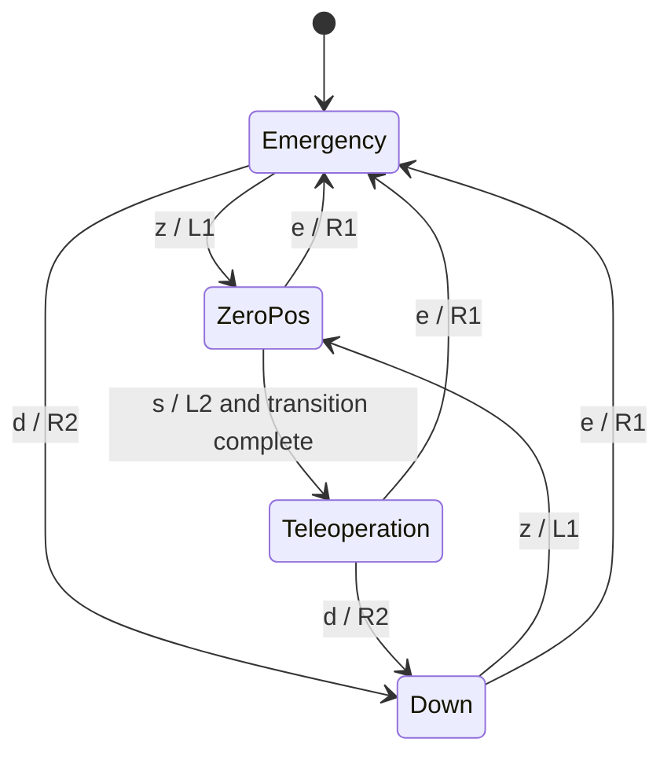

# DR02 Pro State Machine and Pico Control

**English** | [简体中文](STATE_MACHINE_CN.md) ·
[Back to the DR02 Pro Pico Teleoperation Guide](../README.md)

This is the runtime reference for the `dr02_tele` `state_machine`. It describes
interfaces, state transitions, Pico mapping, command protection, and
diagnostics. For real-robot environment preparation and the complete startup
procedure, see [Real-Robot Teleoperation](REAL_ROBOT.md). For simulation
environment preparation and the complete startup procedure, see
[Simulation Teleoperation](SIMULATION.md).

## 1. Control Loop and ROS 2 Interfaces

`state_machine` creates a ROS 2 node named `sdk_deploy`. Its main loop wakes
every 2 ms, but it executes state control and publishes a new command only when
the local receive timestamp for `/JOINTS_DATA` changes. The effective control
rate therefore follows joint feedback; it is not a fixed 500 Hz.

| Interface | Direction | Purpose |
| --- | --- | --- |
| `/JOINTS_DATA` | Subscribe | 31-DoF position, velocity, torque, temperature, and status feedback; each new frame triggers one control update. |
| `/JOINTS_CMD` | Publish | Complete 31-DoF position-PD command. |
| `/gripper/position` | Subscribe | Feedback `[side, position]` from the new Zhixing SDK on RK; created only with `--ee zhixing`. |
| `/gripper/position_cmd` | Publish | Dual-side command `[2, left, right]` for the new Zhixing SDK; first published after fresh grip input, then once every 20 control updates. |
| `/GAMEPAD_KEY` | Subscribe | Optional state input recognizing the strings for L1, L2, R1, and R2. |

`wait data update` means that no `/JOINTS_DATA` frame has arrived. Before the
first frame, the program does not enter its initial state or publish
`/JOINTS_CMD`. Without `--ee zhixing`, it never creates or publishes
`/gripper/position_cmd`.

## 2. Joint-Control Ownership

| Joint indices | Part | Target source in `Teleoperation` |
| --- | --- | --- |
| `0-2` | Waist | Relative headset orientation. |
| `3-9` | Left arm | Dual-arm IK from the left Pico controller's 6D target. |
| `10-16` | Right arm | Dual-arm IK from the right Pico controller's 6D target. |
| `17-28` | Legs | Target captured on state entry; Pico does not update it. |
| `29-30` | Neck | Target captured on state entry; Pico does not update it. |

The state machine always constructs a 31-joint command. Which joint targets a
real robot ultimately accepts also depends on its current Developer Mode. This
project is approved only for Upper-Body Joint Control Developer Mode.

Optional end effectors are separate from these 31 joints. With
`--ee zhixing`, Orin publishes the `std_msgs/msg/Int32MultiArray` command
`[2, left, right]` on `/gripper/position_cmd`; `2` selects both grippers and
the remaining entries are their positions. The RK SDK publishes separate
`[0, left_position]` and `[1, right_position]` feedback messages on
`/gripper/position`.

## 3. State Transitions



| State | Command behavior |
| --- | --- |
| `Emergency` | Captures feedback position on entry and uses position PD to hold that pose. It is not power-off, damping, or a hardware emergency stop. |
| `ZeroPos` | Uses a cubic spline to move all 31 joint commands to zero over three seconds, then holds zero. |
| `Teleoperation` | Initializes Pico/PXREA, seeds targets from the entry pose, updates waist and arms plus any selected end effector, and holds leg and neck targets. |
| `Down` | Moves waist and arms to the down pose over three seconds while holding leg and neck entry targets. |

## 4. Keyboard and Robot Gamepad Input

| Input | Valid state | Result |
| --- | --- | --- |
| `z` / L1 | `Emergency`, `Down` | Request `ZeroPos`. |
| `s` / L2 | `ZeroPos` | Request `Teleoperation`; if the three-second zero transition is still running, the switch occurs when it finishes. |
| `d` / R2 | `Emergency`, `Teleoperation` | Request `Down`. |
| `e` / R1 | Any state | Request the software `Emergency` pose hold. |

Keyboard input is case-insensitive. The robot gamepad publishes
`G20_KEY_L1`, `G20_KEY_L2`, `G20_KEY_R1`, or `G20_KEY_R2` on `/GAMEPAD_KEY`.
If a button is pressed in a state where its transition is not allowed, the
state machine does not switch states and prints why the request was ignored.

## 5. Pico Anchoring and Control Behavior

On entry to `Teleoperation`, the state machine first reads current 31-joint
feedback, initializes IK, targets, and filters, and then starts PXREA. The robot
therefore does not jump directly toward an absolute Pico pose.

Target initialization requires finite feedback for all 31 joints and arm
positions inside the loaded URDF limits, allowing only `1e-4 rad` rounding
tolerance. Invalid seeds are rejected rather than clipped into motion targets;
initialization retries when valid feedback arrives. A finite entry pose is
held, and a non-finite hold pose is not published.

### Controllers Drive the Arms and Optional Grippers

- When a trigger reaches `0.5`, the current controller pose and corresponding
  robot end-effector pose become that side's anchor.
- The first frame after a trigger press only establishes the anchor. Following
  frames use translation and rotation relative to it as the 6D target.
- Releasing a trigger clears that side's anchor. The next press anchors at the
  current robot command pose, avoiding a jump to an old target.
- With `--ee zhixing`, left and right grip values control their corresponding
  grippers independently of the triggers. The default mode ignores grip.
- With `--record`, the left primary button starts or finishes an
  episode, and the left secondary button deletes the most recent completed
  episode. These buttons have no action without recording enabled.
- Right primary/secondary states are read but have no bound function. Left and
  right joystick axes and clicks are neither parsed nor bound.
- The triggers operate independently, but both arm targets are solved together
  in one IK problem.

Controller mapping parameters:

| Parameter | Value |
| --- | ---: |
| Trigger threshold | `0.5` |
| Translation deadband | `0.015 m` |
| Translation scale | `1.2` |
| Maximum translation from anchor | No fixed magnitude cap; reachability and IK residual checks still apply |
| Rotation deadband | `0.035 rad` |
| Maximum rotation from anchor | `1.45 rad` |
| Grip input range | `[0, 1]` |
| Gripper position range | `[0, 1000]`, using `position = grip × 1000` |
| Gripper publication cadence | Once every 20 state-machine control updates |

Translation and rotation deadbands use a continuous mapping: only the amount
beyond the threshold is mapped, so crossing a threshold does not create a
position or angle step.

With Zhixing enabled, entering `Teleoperation` neither opens the grippers nor
uses Pico input cached before entry. The first valid fresh grip packet received
after entry is published immediately; later updates hold the latest target at
the cadence above. Integer positions in `[0,1000]` are converted to CAN
register operations by the SDK on RK. Missing or more than `200 ms` stale
feedback from either gripper produces a rate-limited warning while arm and
waist teleoperation continues. Because RK and Orin clocks differ, freshness is
measured only from the Orin-local steady-clock arrival time; RK time is never
used or compared.

### Headset Drives the Waist

The first valid headset pose after entering `Teleoperation` establishes the
headset and waist anchors. Relative orientation then maps as follows:

| Headset change | Waist target | Scale |
| --- | --- | ---: |
| pitch | Joint `0` | `+0.8` |
| yaw | Joint `1` | `-0.9` |
| roll | Joint `2` | `-0.6` |

The headset angular deadband is `0.006 rad`, and its first-order filter uses
`alpha = 0.88`. Waist output is also subject to software limits and the final
per-feedback slew limit.

## 6. Pico Stream Protection

The state machine uses the monotonic local receive time of Pico data to judge
freshness. This value is not a network-latency measurement.
Control-cycle and stale-data timing use local `steady_clock` differences, so
an incorrect calendar date, including 1970, does not affect these calculations.
Recording timestamps use a separate wall clock; see [Recording](RECORDING.md).

- No valid packet, or no update for more than `200 ms`, enters soft stale hold.
- Soft stale hold freezes the last target actually sent to the robot rather
  than continuing toward an older unissued IK target, and clears the hand and
  headset anchors.
- Soft stale exits after `3` consecutive fresh Pico packets. A held trigger is
  re-anchored at the current controller pose and robot command, so it does not
  need to be released first.
- No update for more than `1000 ms` escalates to hard stale. After recovery,
  all triggers must be released before control can resume.
- Enabled grippers retain the most recent valid grip values and continue
  holding those targets; stale Pico data never changes the cached target.

Only hard-stale recovery remains held when a trigger is still pressed.

## 7. IK and Command-Protection Pipeline

On entry to `Teleoperation`, IK loads the default URDF or the file selected by
`DR02_PRO_TELEOP_URDF`. It locks the 17 waist, neck, and leg joints in the full
31-DoF model, leaving the 14 arm DoFs.

Each fresh Pico state triggers at most one dual-arm solve with up to 50 internal
iterations. Higher-rate joint feedback continues filtering and publishing the
cached result. Protection and shaping occur in this order:

1. Apply a deadband and scale to translation relative to the anchor, with no
   fixed translation magnitude cap. Rotation retains its deadband and
   `1.45 rad` magnitude cap.
2. Solve both position and orientation targets, adding an outward soft cost
   with weight `5.0` when an elbow enters the torso cylinder of radius `0.25 m`.
   Joint-posture and seed-continuity regularization weights are `0.002` and
   `0.2`, respectively; seed continuity is multiplied by five for both elbow
   joints. Continuity is a soft cost, not a hard bound on joint changes.
3. Clamp each internal candidate to the URDF joint-position limits. Accept a
   step only when both the total Cartesian task error and the full objective do
   not increase; otherwise perform up to six backtracking halvings and increase
   damping adaptively.
4. Preserve the best iterate so a worse final numerical iteration is never
   returned.
5. Reject a final candidate if it is non-finite, worsens task cost relative to
   its seed, or leaves either end effector above `0.05 m` position error or
   `15 deg` rotation error. Rejection holds the last arm command actually
   issued and clears smoother velocity.
6. For a valid candidate, limit each joint's raw target advance relative to
   the current issued command to `0.5 rad` per solve. A larger valid solution is
   clipped and continues through the smoother instead of being rejected, so
   fast motion cannot lock the target at an old command.
7. Pass the 14 arm targets through a four-frame weighted average
   `{0.1, 0.2, 0.3, 0.4}` and a critically damped second-order smoother with
   `omega = 30`. Only the smoother integration interval is clamped to `1–5 ms`.
8. Apply independent software limits to waist targets and the URDF limits
   read by the same IK model to arm targets.
9. Limit output relative to the previous issued command to `0.006 rad` per
   feedback frame, then recheck arm output against URDF limits, including
   hold/recovery paths. Reject non-finite commands and restore the previous
   valid command.
10. Compute arm velocity from final position commands as
    `(q_cmd - q_cmd_prev) / dt`, using the measured, unclamped monotonic interval
    between control updates instead of the smoother's internal velocity.

Arm ranges below come from the repository's default `DR02-pro.urdf`. With
`DR02_PRO_TELEOP_URDF`, both IK and arm output use the selected file's ranges.
Waist joints retain the independent software ranges shown below.

| Index | Joint | Output range (rad) |
| ---: | --- | --- |
| `0` | waist z | `[-0.6, 0.6]` |
| `1` | waist x | `[-0.4, 0.4]` |
| `2` | waist y | `[-0.4, 0.4]` |
| `3` / `10` | left / right shoulder y | `[-3.8397, 1.5708]` |
| `4` | left shoulder x | `[-0.349066, 3.49066]` |
| `11` | right shoulder x | `[-3.49066, 0.349066]` |
| `5` / `12` | left / right shoulder z | `[-2.9671, 2.9671]` |
| `6` / `13` | left / right elbow | `[-0.767945, 1.74533]` |
| `7` / `14` | left / right wrist z | `[-2.9671, 2.9671]` |
| `8` / `15` | left / right wrist y | `[-1.5708, 1.5708]` |
| `9` / `16` | left / right wrist x | `[-1.5708, 1.5708]` |

The elbow-cylinder cost is a soft constraint, not mesh collision detection. It
does not detect arm-to-arm contact or protect against the environment or a
person.

## 8. Real-Robot Runtime Safety Monitor

With `BUILD_SIM=OFF`, `SafeController` starts a separate monitoring thread
whose period is configured as `2 ms`. The current implementation performs
these checks:

- It checks that joint position, velocity, and torque are finite. After the
  first joint update has arrived, a joint-feedback timestamp that remains
  unchanged for more than `100 ms` is treated as an error and sets
  `safe_control_mode=3`. Unchanged joint position, velocity, and torque values
  are not treated as errors while complete feedback frames keep arriving.
- It checks the maximum motor temperature once every 1000 monitoring cycles.
  Protection is triggered when the maximum is greater than
  `110 °C`.

Checks that reach an error condition set `safe_control_mode` to a nonzero
value. The state machine checks this value before gating control on fresh
feedback, so it leaves the active control state and enters `Emergency` even if
joint feedback stops completely. No further joint command is generated or
published without fresh feedback; the real robot must still provide an
independent driver or hardware watchdog. The safety monitor does not emit
periodic or error diagnostic output.


## 9. Runtime Diagnostics and Troubleshooting

Periodic diagnostics are disabled by default. When started with
`ros2 run dr02_tele state_machine --log`, `Teleoperation` prints diagnostics
once per second:

```text
[PicoTeleoperation] diag pico_age_ms=... packets=...(total=...)
parse_fail=...(total=...) feedback_hz=... ik_hz=...
ik_reject=...(total=...) ik_limit=...(total=...)
ik_ms(avg/max)=.../...
control_ms(avg/max)=.../... trigger(L/R)=.../... stale=...
```

| Field or symptom | Meaning and first check |
| --- | --- |
| `pico_age_ms` | Milliseconds since the last valid Pico packet arrived; `-1` means invalid receive time, and above 200 means stale protection. |
| `packets` | Valid packets in the last second; zero means check Pico **Send** and Robotics Service. |
| `parse_fail` | JSON parse failures; a growing value suggests a sender format or version mismatch. |
| `feedback_hz` | Actual joint-feedback/control rate; low values indicate `/JOINTS_DATA` or DDS problems. |
| `ik_hz` | Actual IK solve rate. IK runs once per fresh Pico packet instead of repeating at the higher joint-feedback rate. |
| `ik_reject` | IK candidates rejected in the last second and in total; sustained growth calls for checking reachability, singularities, input jumps, and the tracking tradeoff from continuity regularization. |
| `ik_limit` | Valid IK targets whose per-joint advance was clipped to `0.5 rad`; growth during fast motion is expected and does not freeze the smoother. |
| `ik_ms(avg/max)` | Average/maximum IK time; spikes suggest unreachable targets, URDF issues, or host load. |
| `control_ms(avg/max)` | Complete Teleoperation control and publish time. |
| `trigger(L/R)` | Raw trigger values for checking the `0.5` threshold. |
| `stale` | Whether Pico stale hold is active. |

Common startup messages:

| Message | Meaning |
| --- | --- |
| `PXREAInit returned 0` | PXREA initialization call succeeded. |
| `PXREA server connected` | The state machine connected to local Robotics Service. |
| `device found` | Robotics Service discovered the Pico device. |
| `first state JSON` | The first Pico state was received and parsed. |
| `trigger latched` | That side just established an anchor; continue moving to create a relative target. |
| `reject IK candidate` | The candidate failed residual, task-cost, or numeric checks; the arm holds its last issued command. |
| `limit IK target` | A valid IK solution exceeded the per-solve target-advance limit and was clipped instead of rejected. |
| `Pico data stale` | Pico data has not updated for 200 ms; output is frozen while 3 fresh packets are awaited. |
| `Pico data hard stale` | Pico data has not updated for 1000 ms; triggers must be released after recovery. |

In `reject IK candidate`, `pos_err` and `rot_err` are checked against `0.05 m`
and `15 deg`. Exceeding either threshold on either side holds both arms;
decreasing task cost does not override a residual failure. Neither
`converged=0` nor `max_joint_delta` directly rejects a candidate: the per-joint
`0.5 rad` advance limit is applied only after acceptance. This advance limit
is separate from the removed `0.5 m` translation magnitude cap.

## 10. Parameter Locations

- Pico coordinate mapping, deadbands, scaling, software limits, filtering, and
  stale threshold: `manipulation/src/pico_teleoperation.cpp`
- IK weights, iteration count, and elbow soft avoidance:
  `manipulation/src/dr2_arm_ik.cpp`
- State targets and PD gains: `state_machine/state/` and
  `state_machine/include/control_parameters.hpp`

Change one parameter at a time, record diagnostics in simulation first, and
then repeat the complete real-robot safety workflow.

> [!WARNING]
>
> `Emergency`, the safety monitor, Pico stale hold, software limits, and the
> elbow soft cost cannot replace a hardware emergency stop or a clear
> workspace. Keep the physical emergency stop or gamepad red stop button
> immediately reachable throughout real-robot teleoperation.
