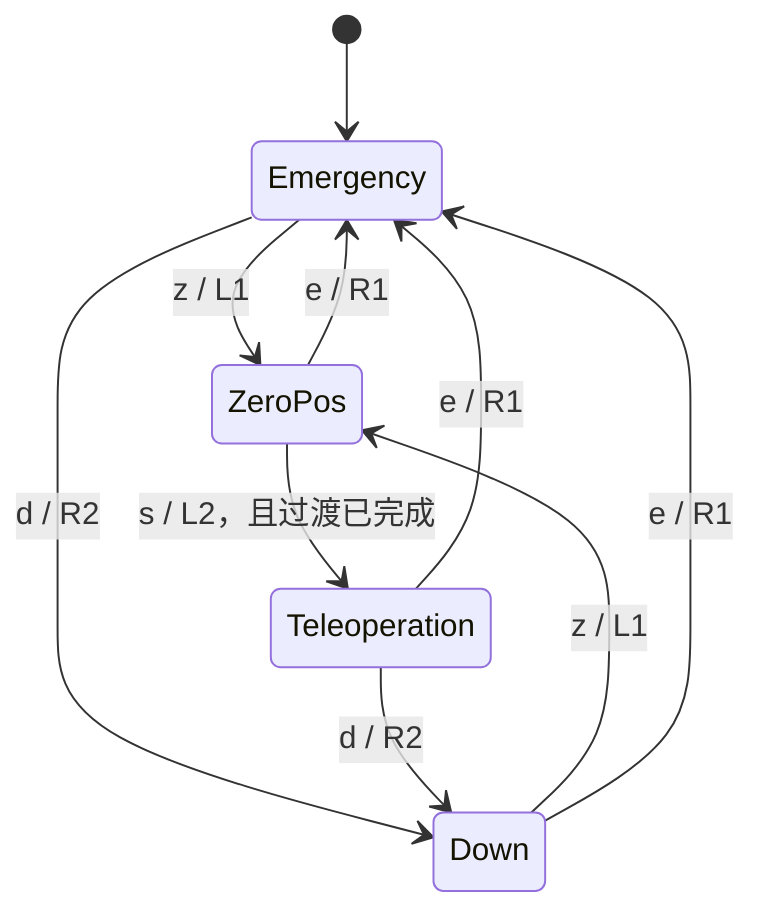

# DR02 Pro 状态机与 Pico 控制

[English](STATE_MACHINE.md) | **简体中文** ·
[返回 DR02 Pro Pico 遥操使用指南](../README_CN.md)

本文档是 `dr02_tele` 的运行参考，说明 `state_machine` 的接口、状态流转、Pico 映射、指令
保护和诊断。真机的环境准备与完整启动步骤参阅[真机遥操](REAL_ROBOT_CN.md)；仿真的环境准备与
完整启动步骤参阅[仿真遥操](SIMULATION_CN.md)。

## 1. 控制循环与 ROS 2 接口

`state_machine` 创建名为 `sdk_deploy` 的 ROS 2 节点。主循环每 2 ms 唤醒一次，但只有
`/JOINTS_DATA` 的本地接收时间戳发生变化时才执行一次状态控制并发布新指令。因此实际控制频率
由关节反馈频率决定，不是固定的 500 Hz。

| 接口 | 方向 | 用途 |
| --- | --- | --- |
| `/JOINTS_DATA` | 订阅 | 31 自由度关节位置、速度、力矩、温度和状态反馈；每个新帧触发一次控制更新。 |
| `/JOINTS_CMD` | 发布 | 完整的 31 自由度位置 PD 指令。 |
| `/GAMEPAD_KEY` | 订阅 | 可选状态切换输入，识别 L1、L2、R1、R2 对应字符串。 |

启动时如果出现 `wait data update` 表示状态机还没有收到第一帧 `/JOINTS_DATA`。首帧到达前，程序
不会进入初始状态，也不会发布 `/JOINTS_CMD`。

## 2. 关节控制归属

| 关节索引 | 部位 | `Teleoperation` 中的目标来源 |
| --- | --- | --- |
| `0-2` | 腰部 | 头显相对姿态。 |
| `3-9` | 左臂 | 左 Pico 手柄的 6D 目标经过双臂 IK 得到。 |
| `10-16` | 右臂 | 右 Pico 手柄的 6D 目标经过双臂 IK 得到。 |
| `17-28` | 双腿 | 保持进入状态时记录的目标；Pico 不更新。 |
| `29-30` | 颈部 | 保持进入状态时记录的目标；Pico 不更新。 |

状态机始终构造 31 关节指令。实机最终采用哪些关节目标，还取决于机器人当前开发者模式；本项目
只允许配合已批准的上半身关节控制开发者模式使用。

## 3. 状态流转



| 状态 | 指令行为 |
| --- | --- |
| `Emergency` | 记录进入该状态时的反馈位置，并使用位置 PD 保持该姿态。它不是断电、阻尼或硬件急停。 |
| `ZeroPos` | 使用三次样条在三秒内将 31 个关节指令插值到零位，然后保持零位。 |
| `Teleoperation` | 初始化 Pico/PXREA，以进入时姿态为初始目标，更新腰部和双臂，保持腿部与颈部目标。 |
| `Down` | 在三秒内将腰部和双臂插值到下垂姿态，同时保持进入该状态时的腿部与颈部目标。 |


## 4. 键盘和机器人手柄输入

| 输入 | 有效状态 | 结果 |
| --- | --- | --- |
| `z` / L1 | `Emergency`、`Down` | 请求进入 `ZeroPos`。 |
| `s` / L2 | `ZeroPos` | 请求进入 `Teleoperation`；若三秒回零尚未结束，状态机会在结束后自动切换。 |
| `d` / R2 | `Emergency`、`Teleoperation` | 请求进入 `Down`。 |
| `e` / R1 | 任意状态 | 请求进入 `Emergency` 软件姿态保持。 |

键盘输入不区分大小写。机器人手柄通过 `/GAMEPAD_KEY` 发送 `G20_KEY_L1`、`G20_KEY_L2`、
`G20_KEY_R1`、`G20_KEY_R2`。如果在不允许的当前状态下按下对应按钮，状态机不会执行切换，
并会在终端输出忽略该请求的原因。

## 5. Pico 锚点与控制行为

进入 `Teleoperation` 时，状态机首先读取当前 31 关节反馈，初始化 IK、目标和滤波器，然后启动
PXREA。此时手臂不会因为 Pico 的绝对位置而直接跳转。

### 手柄控制双臂

- 当某侧 trigger 达到 `0.5` 时，记录该手柄姿态和该侧机器人末端姿态作为锚点。
- trigger 按下后的第一帧只建立锚点，不求解位移；后续帧使用相对锚点的平移和旋转生成 6D
  末端目标。
- 松开 trigger 会清除该侧锚点。下次按下时从当前机器人指令姿态重新建锚，避免沿用旧目标跳变。
- 左右手柄的 primary、secondary、grip、摇杆方向和摇杆按下数据会被接收，但当前不绑定控制功能。
- 左右手柄可以独立扣住，但双臂目标由同一次 IK 联合求解。

手柄映射参数：

| 参数 | 数值 |
| --- | ---: |
| Trigger 阈值 | `0.5` |
| 平移死区 | `0.015 m` |
| 平移比例 | `1.44` |
| 相对锚点最大平移 | `0.5 m` |
| 旋转死区 | `0.035 rad` |
| 相对锚点最大旋转 | `1.45 rad` |

### 头显控制腰部

进入 `Teleoperation` 后，第一份有效头显姿态会建立头显和腰部锚点。之后使用相对姿态控制：

| 头显变化 | 腰部目标 | 比例 |
| --- | --- | ---: |
| pitch | 关节 `0` | `+0.8` |
| yaw | 关节 `1` | `-0.9` |
| roll | 关节 `2` | `-0.6` |

头显角度死区为 `0.006 rad`，一阶滤波系数为 `alpha = 0.88`。腰部最终还会经过软件限位和
每反馈帧限速。

## 6. Pico 断流保护

状态机使用 Pico 数据在本机被接收时的单调时钟判断数据新鲜度，不把它当作网络延迟测量。

- 尚未收到有效 Pico 数据，或最近数据超过 `200 ms` 未更新时，进入 stale hold。
- stale hold 会冻结最近一次真正发送给机器人的目标，不会继续靠近尚未下发的旧 IK 目标。
- 断流时清除手柄和头显锚点，并要求所有 trigger 先松开。
- 数据恢复且检测到所有 trigger 已松开后，才允许重新按下 trigger 建立新锚点。

若恢复时手柄仍扣住，终端不会立即恢复手臂控制，这是预期保护行为。

## 7. IK 与指令保护链路

IK 在进入 `Teleoperation` 时加载默认 URDF，或加载 `DR02_PRO_TELEOP_URDF` 指定的文件。
它在完整 31 自由度模型中锁定腰部、颈部和双腿的 17 个关节，只保留双臂 14 自由度。

每个关节反馈帧最多执行 50 次双臂联合 IK 迭代。保护和整形按实际执行顺序分为：

1. 将手柄相对平移和旋转限制在锚点附近的允许范围。
2. IK 同时优化双臂位置与姿态，并在肘部进入躯干半径 `0.25 m` 的圆柱区域时加入权重 `5.0`
   的向外软代价。
3. 每次 IK 迭代使用 URDF 关节位置上下限裁剪结果。
4. 14 维手臂目标经过四帧加权平均 `{0.1, 0.2, 0.3, 0.4}` 和临界阻尼二阶平滑器
   `omega = 30`。
5. 腰部和双臂目标经过下表的软件限位。
6. 最终输出相对上一条已发送指令的变化量限制为每反馈帧 `0.006 rad`。

| 索引 | 关节 | 软件范围（rad） |
| ---: | --- | --- |
| `0` | waist z | `[-0.6, 0.6]` |
| `1` | waist x | `[-0.4, 0.4]` |
| `2` | waist y | `[-0.4, 0.4]` |
| `3` / `10` | left / right shoulder y | `[-1.2, 1.4]` |
| `4` | left shoulder x | `[-0.7, 1.8]` |
| `11` | right shoulder x | `[-1.8, 0.7]` |
| `5` / `12` | left / right shoulder z | `[-1.6, 1.6]` |
| `6` / `13` | left / right elbow | `[-0.2, 1.8]` |
| `7` / `14` | left / right wrist z | `[-2.6, 2.6]` |
| `8` / `15` | left / right wrist y | `[-1.45, 1.45]` |
| `9` / `16` | left / right wrist x | `[-1.45, 1.45]` |

肘部圆柱代价是软约束，不是网格碰撞检测。它不能检测双臂互撞，也不能保护机器人免于环境或
人员碰撞。

## 8. 真机运行安全监控

`BUILD_SIM=OFF` 时，`SafeController` 启动独立监控线程，线程周期配置为 `2 ms`。当前代码执行
以下检查：

- 检查关节位置、速度和力矩是否包含 `NaN`。收到首个关节更新后，如果关节反馈时间戳超过
  `30 ms` 未变化，也会判定异常；如果某个关节的位置、速度和力矩连续超过 100 个监控周期
  完全相同，同样会判定异常。
- 每 1000 个监控周期检查一次电机最高温度。最高温度高于 `110 °C` 时触发保护。

任一检查失败都会将 `safe_control_mode` 设置为非零。各状态会在下一次状态控制更新时检测该值并
请求进入 `Emergency`。状态机只有在收到新的 `/JOINTS_DATA` 时才执行状态控制；因此如果关节
反馈完全停止，安全请求会保留，但实际状态切换必须等待下一帧关节反馈到达。


## 9. 运行诊断与排障

`Teleoperation` 每秒输出一次诊断：

```text
[PicoTeleoperation] diag pico_age_ms=... packets=...(total=...)
parse_fail=...(total=...) feedback_hz=... ik_ms(avg/max)=.../...
control_ms(avg/max)=.../... trigger(L/R)=.../... stale=...
```

| 字段或现象 | 含义与检查方向 |
| --- | --- |
| `pico_age_ms` | 最近有效 Pico 数据的本机接收时间；超过 200 表示断流保护。 |
| `packets` | 最近一秒收到的有效状态包；为 0 时检查 Pico **Send** 和 Robotics Service。 |
| `parse_fail` | JSON 解析失败数量；持续增加时检查发送端数据格式和版本。 |
| `feedback_hz` | 实际关节反馈与控制更新频率；过低时检查 `/JOINTS_DATA` 和 DDS。 |
| `ik_ms(avg/max)` | IK 平均/最大耗时；异常增大时检查不可达目标、URDF 和主机负载。 |
| `control_ms(avg/max)` | 整个 Teleoperation 控制与发布耗时。 |
| `trigger(L/R)` | 左右 trigger 原始值，用于检查是否达到 `0.5`。 |
| `stale` | 是否正在执行 Pico 断流保持。 |

常见启动日志：

| 日志 | 含义 |
| --- | --- |
| `PXREAInit returned 0` | PXREA 初始化调用成功。 |
| `PXREA server connected` | 状态机已连接本机 Robotics Service。 |
| `device found` | Robotics Service 已发现 Pico 设备。 |
| `first state JSON` | 已收到并解析第一份 Pico 状态。 |
| `trigger latched` | 该侧刚建立锚点，需继续移动手柄才产生相对目标。 |
| `Pico data stale` | Pico 数据超过 200 ms 未更新，输出已冻结。 |

## 10. 参数位置

- Pico 坐标映射、死区、比例、软件限位、滤波和断流阈值：
  `manipulation/src/pico_teleoperation.cpp`
- IK 权重、迭代次数和肘部软避让：`manipulation/src/dr2_arm_ik.cpp`
- 状态目标和 PD 参数：`state_machine/state/` 与
  `state_machine/include/control_parameters.hpp`

调参时一次只修改一个变量，先在仿真中记录诊断结果，再按完整真机安全流程重新验证。

> [!WARNING]
>
> `Emergency`、安全监控、Pico 断流保持、软件限位和肘部软代价都不能替代硬件急停与安全工作
> 空间。真机遥操期间必须始终确保实体急停或手柄红色停止按钮可立即触及。
